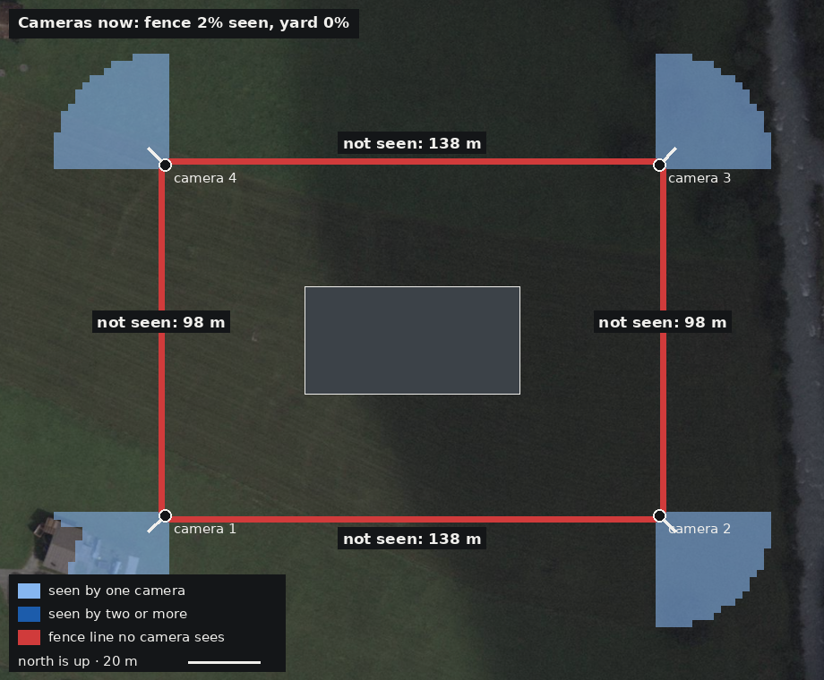
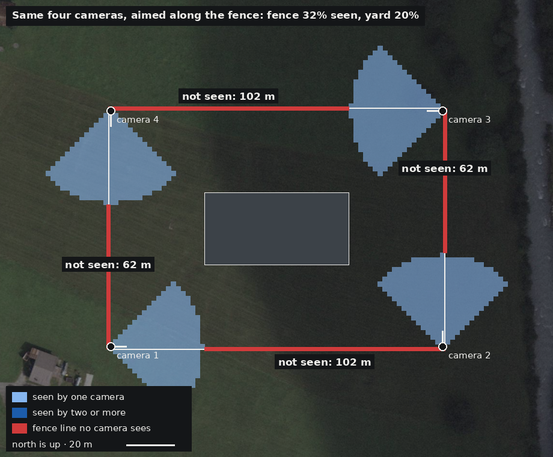
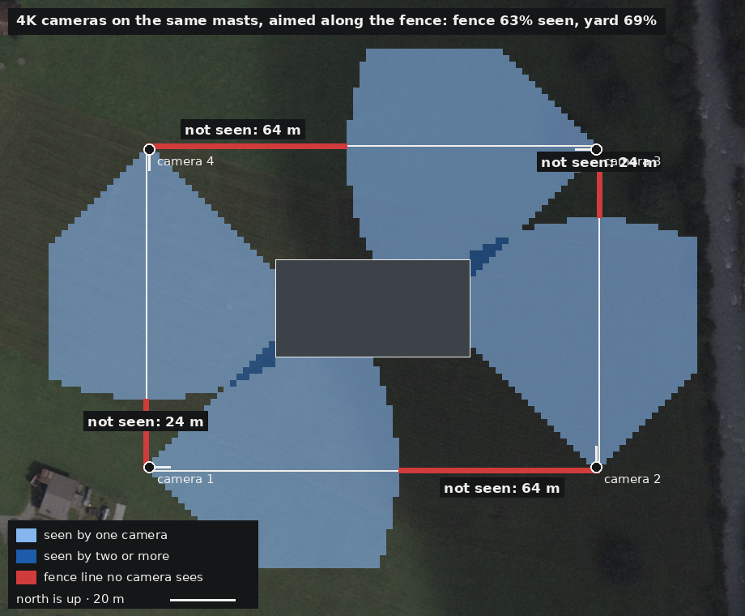

# Warehouse site: security assessment from simulation

Site: a synthetic warehouse compound on measured terrain, Lauterbrunnen valley, Bernese Oberland (CH). The compound is notional: it was placed by rule on open ground and is not a real facility. The ground, the surrounding buildings and the tree cover are measured public data.

## Summary

1. **The fixed cameras cover little of the fence.** Counting only where a camera reaches the density needed to detect a person (IEC 62676-4, 25 px/m), the four corner cameras as first laid out see 2% of the 480 m fence line and 0% of the yard. Aimed along the fence: 32% and 20%. With 4K cameras on the same masts: 63% and 69%.
2. **Early detection depends on the drone.** With everything working, an approaching person is detected after 68 s. With its camera out, detection takes 555 s. Over 30 days the drone is on its charger 53% of the time.
3. **With two sensors out, about one intrusion in 5 is not stopped in time.** In the hard case (protection timeline, first drone's camera and the fence sensor out, at a random time in the shift) the intruder is met before finishing in 97 of 120 runs (95% interval 73% to 87%).

**Recommended first step (ORION):** fit 4K cameras to the corner masts, aimed along the fence. Cameras see 63% of the fence line and 69% of the yard (now 2% and 0%). Hard case (drone camera and fence sensor out, intrusion at a random time across equipment charge cycles): intruder met in time 119/120 (95% interval 95%-100%) (now 97/120 (95% interval 73%-87%)), detected after 467 s (now 502 s). The paired runs cannot tell this apart from: Camera masts at the middle of both long sides. Cost: USD 2,000 to USD 8,000 once, nothing a year (assumed: four 4K bullet cameras at $500-2,000 each installed, swapped onto the existing masts and re-aimed along the fence).

## What was assessed, and how

- **Measured:** terrain (1 m in the site scene, 4 m in the valley), aerial imagery, surrounding buildings, tree canopy height. Source: swisstopo open data; roads and paths from OpenStreetMap.
- **Placed:** the compound (140 by 100 m, fenced, one gate, 2.95 m of relief) with two guards, a robot dog, a patrol vehicle, a drone and four camera masts.
- **Simulated:** a deterministic event simulation. Each drill is run over 40 seeds (120 for the measured improvements), because detection is a chance per second that depends on distance, camera resolution, field of view and line of sight. Intrusions start at a random time 1 to 9 hours into the shift, so the drone, robot dog and vehicle are met charging, low or mid-patrol as they would be. Guards and machines observe, detect, report and go to meet a person. No use of force is modelled. Rates are given with exact 95% intervals.
- **Assumed:** equipment speeds, battery sizes and sensor ranges are round class figures; barrier delays, gate check times and catch rates are placeholders. They are listed at the end.

## Findings

### Camera coverage

| Layout | Cameras | Fence line seen | Fence not seen | Yard seen | 30 m outside seen |
|---|---:|---:|---:|---:|---:|
| As first laid out, facing outward | 4 | 2% | 472 m | 0% | 19% |
| Same four, aimed along the fence | 4 | 32% | 328 m | 20% | 13% |
| Same four with 4K cameras, aimed along the fence | 4 | 63% | 176 m | 69% | 42% |
| Two more mid-way, all facing outward | 6 | 2% | 468 m | 0% | 30% |

A point counts as seen when a camera reaches the IEC 62676-4 detect density there (25 px/m on a person: 38 m for the 1080p cameras with a 90 degree lens, 77 m for 4K), inside its field of view, with a clear line of sight over the measured terrain, buildings and canopy. This is where a camera could detect someone in daylight, not whether an operator would notice.

### Detection and response to a person walking in

| Case | Detected | Time to detect | Detection to being met | In the alarm zone first |
|---|---:|---:|---:|---:|
| Unknown person walks in across open ground | 40/40 | 68 s (60 to 81) | 214 s | 0/40 |
| Same approach, camera mast-3 out of service | 40/40 | 68 s (60 to 81) | 214 s | 0/40 |
| Same approach, drone camera out of service | 40/40 | 555 s (513 to 614) | 147 s | 40/40 |

### Protection timeline: fence, then a door

The person crosses the fence (30 s), walks to a door and works on it (90 s). The fence sensor alarms 95% of the time and is checked from inside the yard.

| Case | Met before the door gives way | 95% interval | Seen before the fence | Task completed |
|---|---:|---:|---:|---:|
| All sensors working | 39/40 | 87% to 100% | 30/40 | 1/40 |
| Drone camera out | 38/40 | 83% to 99% | 20/40 | 2/40 |
| Drone camera and fence sensor out | 32/40 | 64% to 91% | 20/40 | 8/40 |

"Seen before the fence" counts runs where the person was detected and either never reached the fence or was detected before reaching it.

By approach direction in the hard case: north 32/40, north-east 8/40, east not walkable, south-east 40/40, south 24/40, south-west 32/40, west not walkable, north-west 38/40. The weakest side is the north-east.
Dependence on the assumed door delay, same case: 45 s door 32/40, 90 s door 32/40, 180 s door 33/40.

### Fence alarms

30 days at 3 nuisance alarms a day (a poorly tuned sensor).

| Procedure | Alarms | Guards sent | Guard hours | Robot dog hours | Drone hours |
|---|---:|---:|---:|---:|---:|
| A machine checks first | 94 | 0 | 0.2 | 0.8 | 0.5 |
| Everyone responds | 94 | 114 | 6.5 | 3.1 | 0.9 |

A real intrusion during a nuisance alarm was met in time in 38/40 runs when a machine checks first and 38/40 when everyone responds.

### Gate and fictitious pickups

A 10-hour shift, about 4 trucks an hour, one on a fictitious booking.

| Check | Fictitious pickup stopped | Mean wait | Longest wait | Longest queue |
|---|---:|---:|---:|---:|
| Paper only | 12/40 | 3 min | 16 min | 3 |
| With call-back | 38/40 | 9 min | 35 min | 5 |

The share stopped is close to the assumed catch rate by construction. What the simulation adds is the price in waiting time.

### Evacuation

All 12 staff reached the muster point in 40/40 drills; the last person after 178 s (139 to 217). With the nearest exit blocked: 247 s (221 to 297). Both are best cases: no smoke, no crowding, nobody missing.

### Equipment over 30 days

| Equipment | Distance | Charge cycles | Capacity left | Available |
|---|---:|---:|---:|---:|
| Robot dog | 2,367 km | 172 | 97% | 85% |
| Drone | 14,291 km | 889 | 82% | 47% |
| Patrol vehicle | 12,577 km | 93 | 98% | 67% |

## Recommendations, ranked

Each measure was run in the simulation on the hard case (protection timeline, first drone's camera and the fence sensor out; baseline 97/120 met in time, 95% interval 73% to 87%) over 120 seeds, every measure on the same seeds and intrusion times, then ranked by ORION, the decision engine, with these numbers and the rough costs as evidence. Measures whose paired runs cannot be told apart (exact McNemar test, 5% level) are marked as tied: between them, the ranking rests on cost and ORION's judgment, not on a measured difference.

| Measure | Met in time | 95% interval | Different from now? | Tied with |
|---|---:|---:|---:|---|
| 4K cameras on the four corner masts, aimed along the fence | 119/120 | 95% to 100% | yes (p = 0.000) | Camera masts at the middle of both long sides |
| Camera masts at the middle of both long sides | 114/120 | 89% to 98% | yes (p = 0.000) | 4K cameras on the four corner masts, aimed along the fence |
| Re-aim the four corner cameras along the fence | 97/120 | 73% to 87% | no (p = 1.000) | none |
| A second drone on the same circuit | 111/120 | 86% to 97% | yes (p = 0.003) | A second guard on foot patrol |
| A second guard on foot patrol | 113/120 | 88% to 98% | yes (p = 0.002) | A second drone on the same circuit |

| # | Measure | Rough cost | Chance it is first | Evidence |
|---:|---|---|---:|---|
| 1 | Fit 4K cameras to the corner masts, aimed along the fence | $2,000 to $8,000 once | 16% | Cameras see 63% of the fence line and 69% of the yard (now 2% and 0%). Hard case (drone camera and fence sensor out, intrusion at a random time across equipment charge cycles): intruder met in time 119/120 (95% interval 95%-100%) (now 97/120 (95% interval 73%-87%)), detected after 467 s (now 502 s). The paired runs cannot tell this apart from: Camera masts at the middle of both long sides. Cost: USD 2,000 to USD 8,000 once, nothing a year (assumed: four 4K bullet cameras at $500-2,000 each installed, swapped onto the existing masts and re-aimed along the fence). |
| 2 | Re-aim the four corner cameras to look along the fence | $0 to $2,000 once | 39% | Cameras see 32% of the fence line and 20% of the yard (now 2% and 0%). Hard case (drone camera and fence sensor out, intrusion at a random time across equipment charge cycles): intruder met in time 97/120 (95% interval 73%-87%) (now 97/120 (95% interval 73%-87%)), detected after 502 s (now 502 s). The paired runs cannot tell this apart from: As it is now. Cost: USD 0 to USD 2,000 once, nothing a year (no new equipment; a technician's visit to re-aim four cameras (assumed up to $2,000)). |
| 3 | Add a second drone on the patrol circuit | $15,000 to $50,000 once | 5% | Hard case (drone camera and fence sensor out, intrusion at a random time across equipment charge cycles): intruder met in time 111/120 (95% interval 86%-97%) (now 97/120 (95% interval 73%-87%)), detected after 298 s (now 502 s). The paired runs cannot tell this apart from: A second guard on foot patrol. A drone is available 73% of the time (now 47%). Cost: USD 15,000 to USD 50,000 once, nothing a year (one surveillance drone at $15,000-50,000 to buy; no subscription price was found). |
| 4 | Check fence alarms by drone or robot dog before sending guards | no equipment | 19% | Over 30 days and 94 nuisance alarms: guards sent 0 times and 0.22 guard hours (114 times and 6.52 hours when everyone responds). Intrusion during a nuisance alarm met in time 38/40 (38/40 when everyone responds). 1 alarms found no machine free. Cost: none; saves about 6 guard hours a month. |
| 5 | Add camera masts at the middle of both long sides | $12,000 to $90,000 once | 2% | Cameras see 3% of the fence line and 0% of the yard (now 2% and 0%). Hard case (drone camera and fence sensor out, intrusion at a random time across equipment charge cycles): intruder met in time 114/120 (95% interval 89%-98%) (now 97/120 (95% interval 73%-87%)), detected after 465 s (now 502 s). The paired runs cannot tell this apart from: 4K cameras on the four corner masts, aimed along the fence. Cost: USD 12,000 to USD 90,000 once, nothing a year (two installed thermal cameras at $3,000-15,000 each, times 2-3 for poles, cabling, recording and integration). |
| 6 | Add a second guard on foot patrol | $245,280 to $367,920 a year | 5% | Hard case (drone camera and fence sensor out, intrusion at a random time across equipment charge cycles): intruder met in time 113/120 (95% interval 88%-98%) (now 97/120 (95% interval 73%-87%)), detected after 431 s (now 502 s). The paired runs cannot tell this apart from: A second drone on the same circuit. Cost: nothing once, USD 245,280 to USD 367,920 a year (one more post staffed all year at $28-42 an hour fully loaded). |
| 7 | Confirm every pickup by phone at the gate before admitting | no equipment | 14% | Fictitious pickup stopped in 38/40 shifts (12/40 with a paper check); mean wait 9 min (3 min); longest wait 35 min (16 min). The catch rates (0.95 against 0.35) are assumed, not measured. Cost: no equipment; the gate guard's time and the drivers' waiting. |

Agreement between ORION's five ranking methods: 0.59 (1 means identical orders). ORION is advisory: it ranks the evidence it is given.

## Assumptions and limits

- Drone: 80 Wh at 180 W, camera range 300 m. Robot dog: 236 Wh at 120 W. Camera masts: 1080p visible cameras with a 90 degree lens, detect range 38 m (IEC 62676-4, 25 px/m); chance of noticing rises to its full value at 63 px/m. Class figures, not product data.
- Capacity fade 0.02% per cycle; sight ends after 25 m of foliage; off-path walking at 0.6 of path speed.
- Fence delay 30 s, door delay 90 s, fence sensor detection 95%; gate check 5 to 10 min, call-back 2 to 5 min more; catch rates 0.35 (paper) and 0.95 (call-back).
- Agents are moving points on real route and sight geometry. There is no flight controller or gait model. Fixed cameras are modelled by resolution and lens only: no lighting, compression, mounting blur or video analytics. The drone, robot dog, vehicle and guards keep a simpler range model. No night, no weather. A machine sent to check an alarm is assumed never to be wrong.
- Costs are public price ranges found by search in November 2026, mostly from vendors and trade press. They are rough and are not quotes.
- The site is notional. Nothing here describes the security of a real facility.

## Sources

- [Sandia National Laboratories, physical security modeling (probability of interruption)](https://www.osti.gov/servlets/purl/1807772)
- [Sandia, tables for trials and failures with Pd at a designated confidence level](https://www.osti.gov/servlets/purl/1326340)
- [Axis, pixel density based on IEC 62676-4](https://whitepapers.axis.com/en/pixel-density-based-on-iec-62676-4-2014)
- [Verisk CargoNet, 2025 cargo theft analysis](https://www.verisk.com/company/newsroom/cargo-theft-losses-surge-to-estimated-$725-million-in-2025-verisk-cargonet-analysis-reveals/)
- [FreightWaves, GXO deploys robots and drones for warehouse security](https://www.freightwaves.com/news/gxo-deploys-robots-and-drones-from-asylon-for-warehouse-security)
- [DHL, facility patrolling (limits of automated systems)](https://dhl.com/cl-en/microsites/csi/innovation-warehouse/physical-and-digital-security/facility-patrolling.html)
- [VA perimeter intrusion detection specification (nuisance alarm limits)](https://www.wbdg.org/FFC/VA/VANCAS/VANCA283100.pdf)
- [Fire Technology 2019, variation of pre-movement time in evacuation](https://link.springer.com/article/10.1007/s10694-019-00881-1)
- [robotics.press, what security robots cost in 2026](https://robotics.press/news/security-robot-pricing-2026/)
- [latestcost.com, thermal security camera installed costs](https://latestcost.com/thermal-security-camera-price-equipment-installation-costs/)
- [ASIS International, Security Risk Assessment Standard](https://www.asisonline.org/security-news/press-room/2024/security-risk-assessment-standard/)
- [NVIDIA Omniverse, warehouse digital twin use cases](https://docs.omniverse.nvidia.com/digital-twins/latest/warehouse-digital-twins/use-cases.html)

Reproduce: `world/scripts/run_flow.sh ch-lauterbrunnen`. Simulation digest 7a55dde40762; ORION evidence digest bcb0ec491219; model jev-1.14.0.
